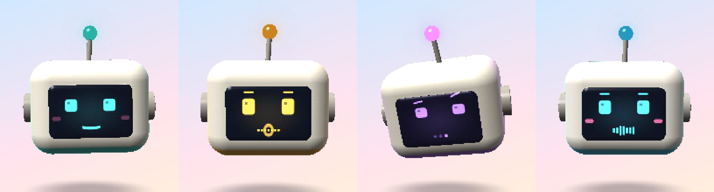
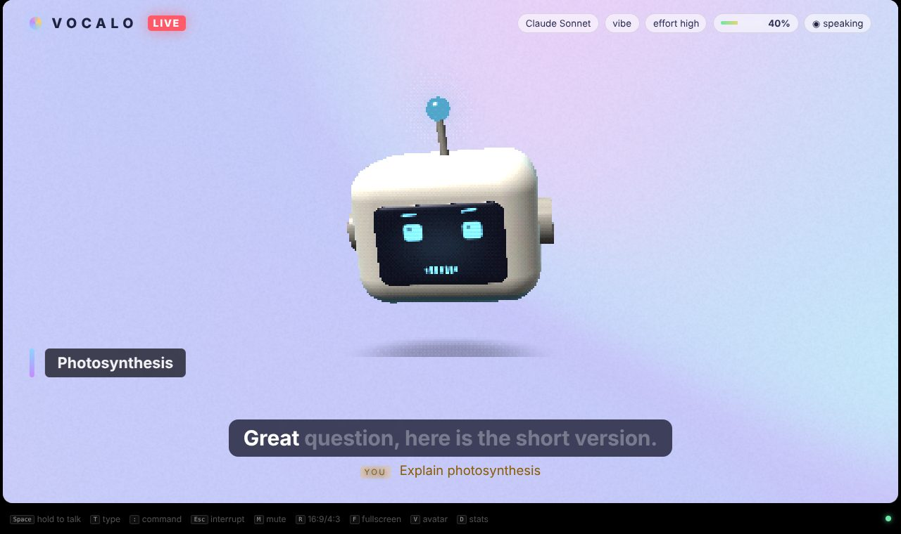
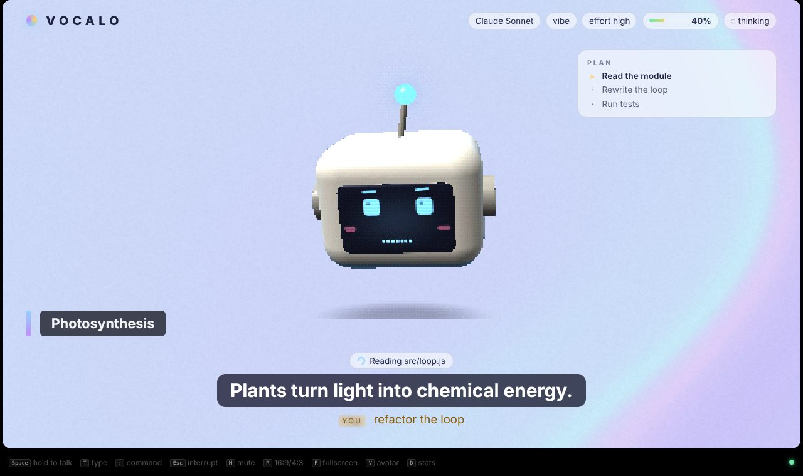
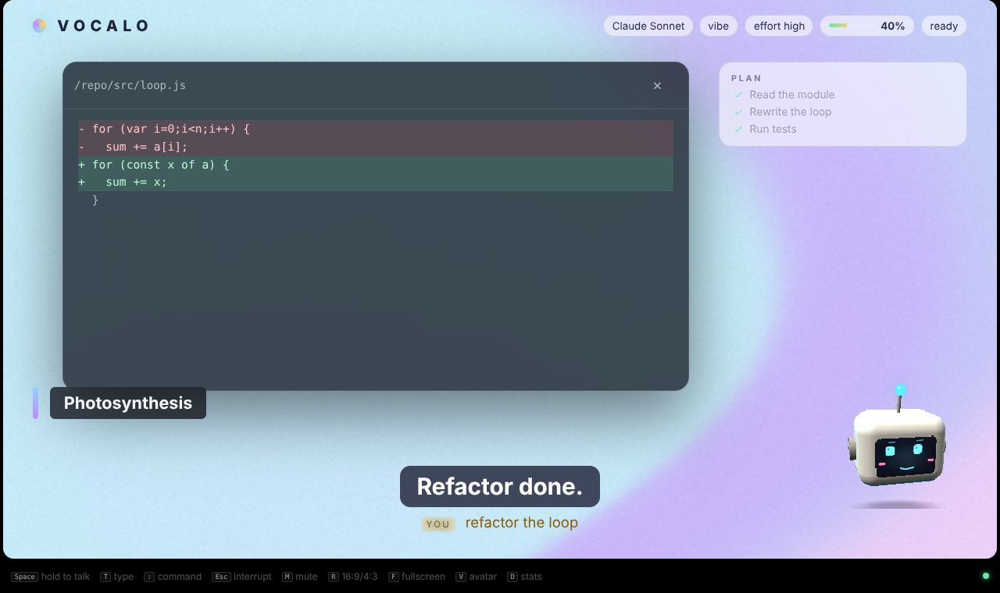
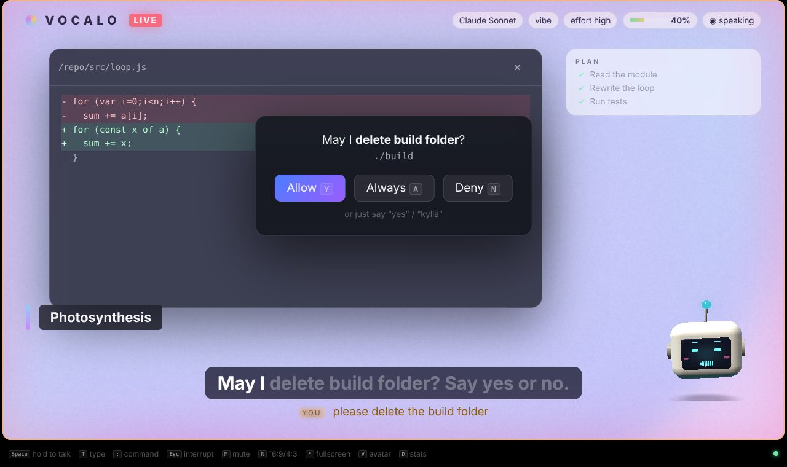
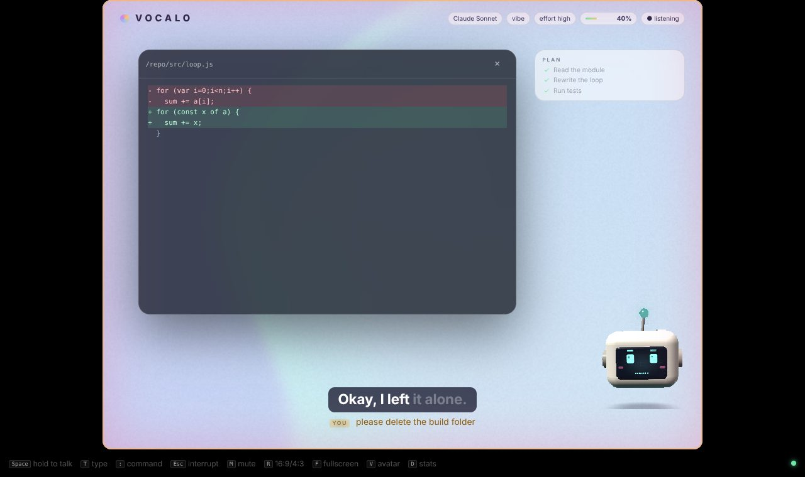

# Vocalo

**Talk to your coding agent like it's live TV.**
Vocalo is a voice-first stage for [ACP](https://agentclientprotocol.com) agents. It's built for **Kiro CLI V3**
(`kiro-cli acp --agent-engine=v3`), and any ACP agent works. You talk; it answers in a warm female voice, with
broadcast-style subtitles, an audio-reactive visual, the agent's plan, and its code changes on screen.

Speech runs **locally on your Mac** (Apple Silicon). The agent runs **on the Mac or on a server over SSH**:
you talk on the laptop, and files, edits, git and Kiro sessions stay on the server.


*Voxi, the default avatar — idle · listening · thinking · speaking.* ▶ [20-second demo video](docs/vocalo-demo.mp4)


*Alternative avatar: the light face, with the night theme.*

| speaking | agent working (plan) | code change | permission | push-to-talk, 4:3 |
|---|---|---|---|---|
|  |  |  |  |  |

*(Screens rendered from the mock agent with software WebGL in `?lite` mode; on a Mac GPU it's full resolution.)*

---

## Contents
1. [Quick start](#quick-start)
2. [The stage (UI)](#the-stage-ui)
3. [Profiles](#profiles)
4. [How the conversation feels](#how-the-conversation-feels-talker--thinker)
5. [Latency](#latency)
6. [Remote mode (SSH)](#remote-mode-talk-on-the-mac-kiro-works-on-the-server)
7. [Controlling Kiro](#controlling-kiro)
8. [Models: research and choices](#models-research-and-choices)
9. [Architecture](#architecture)
10. [Development](#development)
11. [Roadmap and known unknowns](#roadmap-and-known-unknowns)

---

## Quick start

```bash
brew install uv node                 # Node 22+, uv for Python
./scripts/setup-mac.sh               # venv, models, one-time voice design, TTS/STT benchmark
cp vocalo.config.example.json vocalo.config.json && $EDITOR vocalo.config.json   # kiro-cli path, project
mkdir -p ~/code/proj/.kiro/steering && cp steering/vocalo.md ~/code/proj/.kiro/steering/
npm start                            # opens the stage in an app window; just talk
```

| try it | command |
|---|---|
| no mic, no Kiro, no models | `npm run demo` (mock agent, type with `T`) |
| health check | `npm run doctor` · `node src/index.js --remote me@box:/proj --doctor` |
| what models does Kiro offer | `node src/index.js --list-models` |
| a profile | `node src/index.js -p server` · `--list-profiles` |
| terminal instead of window | `node src/index.js --ui tui` (or `both`) |

## The stage (UI)

The stage is a web page that Vocalo serves on `http://127.0.0.1:8766`, opened as an **app window**. No Electron:

1. **Chrome / Edge / Brave / Arc `--app` window** (default if one is installed): chromeless, its own profile. Starts instantly.
2. **Tauri** (`desktop/`): a native ~10 MB `.app` on the system WebView (WKWebView), with no bundled Chromium.
   `cd desktop && npm i && npm run build`. `vocalo` then opens it automatically.
   Electron isn't "bad", it just ships its own 150 MB+ Chromium. Tauri uses the one already in macOS.
3. **Safari → File → Add to Dock** turns the page into a Dock app with no tooling at all.
4. Any browser, **another screen** (`"ui": {"host": "0.0.0.0"}`): put the stage on an iPad or TV on your LAN.

**Visuals** use [Paper Shaders](https://github.com/paper-design/shaders) (WebGL2, Apache-2.0), driven by live audio levels from the speech engine:

- **Background:** a *mesh gradient* in the scene colour, tinted per state: warm while listening, violet swirl while thinking, bright while speaking.
- **Orb:** a *smoke ring* that breathes with **your voice** while listening and with **Vocalo's voice** while speaking, and spins up while Kiro thinks. It moves to the corner when content is on screen.
- **Attention border:** a *pulsing border* while you hold push-to-talk or a permission is waiting.
- **On screen:** subtitles revealed word by word at speaking pace; a lower third; plan panel; colored diffs; images and screenshots
  (remote paths are fetched over SSH); tool ticker; permission card; session picker.
- `?lite` renders at lower resolution (old GPUs, battery). If WebGL is unavailable, a CSS fallback is used.

**Keys:** hold `Space` = push-to-talk (works in hands-free mode too) · `T` type · `:` or `⌘K` command palette · `Esc` interrupt ·
`M` mute · `V` avatar (bot/face/orb) · `R` 16:9 ⇄ 4:3 · `F` fullscreen · `C` clear · `P` plan · `D` latency stats · `Y/A/N` permission · `O` open sign-in page.

Global hotkey without Swift: bind a key in Hammerspoon or Karabiner to `curl -XPOST localhost:8766/command -d '{"type":"ptt","active":true}'`.

## Profiles

A profile is a named partial config, deep-merged over `vocalo.config.json`. Profiles can `extends` each other, and CLI flags win.
The example config ships these:

| profile | what it changes |
|---|---|
| `kiro` | defaults: Kiro on this Mac |
| `fast` | fastest model, `effortLevel: low`, Kokoro for English, earlier filler |
| `server` | extends `fast`, plus Kiro on `me@devbox` over SSH (remote mode) |
| `coach` | deeper answers, a teaching **persona** (`personas/coach.md`), a calmer **designed voice** |
| `tv` | LAN-visible kiosk stage for a big screen |

A profile can set anything: `agent` (model, effort, mode), `remote`, `conversation` (verbosity, busy policy,
permissions, `persona` as text or a `.md` path), `speech` (`voiceDesc` designs a new VoxCPM2 voice per profile, cached; `ttsEn: "kokoro"`), `talker`, `ui`.

## How the conversation feels: talker + thinker

Kiro is the **thinker**. It's smart, but it can take a second before its first word and minutes when it works.
A small, fast **talker** model keeps the conversation human in the meantime:

| moment | what you hear | who |
|---|---|---|
| you stop talking | ~0.3–0.6 s: a *contextual* acknowledgement ("Joo, katsotaan ne testit.") | talker |
| Kiro answers | the real answer, streamed sentence by sentence | Kiro |
| Kiro works silently with tools | every ~7 s, a short progress line ("Ajan nyt testit…") | talker (or a template) |
| you interrupt | audio stops within one 32 ms frame; Kiro is told exactly what you heard | Vocalo |

The talker is **never on the critical path**. It has a 900 ms deadline, its output is guarded (short, no answers, no questions),
and if it's late, pre-rendered fillers play instead. Any OpenAI-compatible endpoint works:
`pip install mlx-lm && mlx_lm.server --model mlx-community/Qwen3-4B-Instruct-2507-4bit --port 8080` (fully local), LM Studio, Ollama, or a fast cloud model.
`--doctor` measures it and prints Finnish and English samples. Listen to them: small local models vary a lot in Finnish.

**Persona** (`src/core/voice-preamble.js` + `steering/vocalo.md`):
- reacts to what you said, and mirrors your language (Finnish, English or a mix), your register and your energy
- keeps turns short, and hands the floor back with a natural question when it helps
- reads speech-recognition errors charitably and confirms best guesses briefly
- is warm but **not sycophantic**: no "great question", and it tells you kindly when you're wrong (for a coding agent, agreeing is a bug)

Answer length is set with `:verbosity short|normal|deep` or by saying "Vocalo, kerro tarkemmin" / "lyhyemmin".

**Honest interrupts.** ACP can't edit the agent's history, so after a barge-in the next prompt carries
`[Vocalo note: … They heard only: "…"]`, and Kiro continues from what you actually heard.
**Thought merging:** if you pause and keep talking before Vocalo has said anything, both parts go out as one prompt.

## Latency

Target: ChatGPT- or Claude-voice feel, **under ~1 s from the end of your sentence to the first sound**.

| step | target | how |
|---|---|---|
| end-of-speech | 200–250 ms | Silero VAD `stop_ms=200` + **Smart Turn** instead of a 700 ms+ silence timeout |
| STT final | ≈0 ms extra | **speculative STT**: Parakeet starts at the first pause *in parallel* with Smart Turn; that transcript becomes the final |
| first sound | 300–600 ms | **talker ack** (or a pre-rendered filler) |
| agent first token | 400–900 ms+ | the big one: fast Kiro model, `effortLevel: low`, lean project (see below) |
| TTS first audio | 150–400 ms | first chunk released at the first clause; streamed synthesis; next sentence synthesized while the current one plays |

**One GPU lane.** STT and TTS share one prioritized MLX thread: final transcript > TTS step > partials. No GPU contention,
which is the classic cause of a "sometimes laggy" feel.

**Playbook, in order of impact:**
1. Pick a fast agent model (`--list-models`) and `effortLevel: low`. Agent time-to-first-token is usually 60–80 % of the total.
2. Keep the voice project lean: every MCP server and big steering file adds tokens to every turn.
3. Run `--bench` on your Mac and aim for TTS ≥ 1.3× realtime. Otherwise use `--timesteps 5`, the 4-bit model, or Kokoro for English.
4. Tune endpointing: `--stop-ms 160` (snappier) or `--turn-threshold 0.6` (fewer cut-offs).
5. Measure everything: `D` in the stage shows per-turn numbers, and `--metrics turns.jsonl` logs them.

## Remote mode: talk on the Mac, Kiro works on the server

```
MacBook: mic → VAD → STT ─┐                        ┌─ dev box / cloud VM / Tailscale host
         speaker ← TTS ←──┤ Vocalo ══ ssh -T ══════┤  kiro-cli acp --agent-engine=v3
         stage  ← events ←┘   (ACP JSON-RPC)       └─ repo, files, edits, tests, ~/.kiro sessions
```

```bash
vocalo --remote me@devbox:/home/me/project --doctor   # ssh, RTT, kiro, steering, ACP handshake, options
vocalo --remote me@devbox:/home/me/project --resume last
vocalo -p server                                      # same, from a profile
```

- **One multiplexed SSH connection** (`ControlMaster`, kept 10 min) carries the ACP stream and side reads
  (`:show file`, images and screenshots in `[[show image=/remote/path.png]]`, `:sh git status`): each costs about one RTT.
- `BatchMode=yes` means key or agent auth only, so it never hangs on a password prompt. Kiro runs in a login shell (`bash -lc`), so your PATH works.
- **Drops survive.** If SSH or Kiro dies, Vocalo reconnects with backoff and re-attaches to the *same* session
  (`session/load`, no transcript replay). It never auto-resends the interrupted prompt (Kiro's rule).
- **Sign-in on the Mac.** When remote Kiro needs browser auth (`_kiro/openExternalUrl`), the stage shows a button,
  and the page opens in the **Mac's** browser on your click. Kiro requires a visible user action.
- Paths in `:show` and `[[show image=…]]` refer to the **remote** machine; prefix `mac:` for a local file.
- Put `steering/vocalo.md` in the **remote** project's `.kiro/steering/`.

## Controlling Kiro

Every command works three ways: **typed** (`:` palette), **spoken** ("Vocalo, …", EN or FI) or over **HTTP**
(`POST :8766/command {"type":"command","line":"model haiku"}`). Commands run locally and instantly, with no LLM round-trip.
Anything unknown starting with `/` goes to Kiro as its own slash command.

| command | voice (examples) | what it does |
|---|---|---|
| `:model [x]` | "Vocalo, switch to model haiku" · "vaihda malliin haiku" | list or switch model (`session/set_config_option`); click to pick |
| `:effort low\|high` | "effort low" · "ajattele vähemmän" | reasoning effort |
| `:mode [x]` | "switch to spec mode" · "vaihda tilaan spec" | Kiro agent mode |
| `:sessions` / `:resume N\|last` | "show sessions" · "jatka edellistä sessiota" | `session/list` + `session/load`; click to resume |
| `:new` | "Vocalo, uusi sessio" | fresh session, keeps model and effort |
| `:steer <text>` | *(just talk while it works)* | add guidance to the running turn (`_session/steer`) |
| `:cancel` | "stop" · "seis" · "peru" | cancel the turn (pending permissions first, per Kiro) |
| `:verbosity short\|normal\|deep` | "kerro tarkemmin" · "lyhyemmin" | answer length |
| `:compact` / `:context` | "tiivistä" · "how much context left" | context management; auto-compacts at 85 % |
| `:show <path>` / `:sh <cmd>` | "show file src/app.js" | view a file or screenshot, or run a quick command, on the agent's machine |
| `:diff` / `:plan` | "show the diff" · "näytä suunnitelma" | last code change / the live plan |
| `:permissions ask\|allow\|deny` | "salli kaikki" · "kysy ensin" | tool approvals; "yes, always" stores Kiro consent |
| `:busy steer\|interrupt\|queue` | | what talking during agent work does |
| `:usage` `:mcp` `:agent` `:options` | | Kiro account usage, MCP status, connection and extensions, all options |

**Talking while Kiro works** (`busyPolicy`, default `steer`):
- While a tool runs, your words are injected into the running turn with Kiro's live steering. The refactor
  keeps going and picks up "also add tests". A cough only mutes the narration.
- When Vocalo is just talking, talking over it interrupts, like a normal conversation.
- `queue` holds what you say until the turn ends. `interrupt` always cancels.

All Kiro extensions are used **only if the running server advertises them** (`agentCapabilities._meta.kiro.extensionMethods`),
as Kiro requires. Other ACP agents get standard ACP.

## Models: research and choices

Researched Nov 2026 for a **MacBook Pro M5 Pro, 48 GB**, with English + Finnish + mixed speech and a female voice.

### Speech-to-text
| model | why / why not |
|---|---|
| **Parakeet TDT 0.6B v3** (NVIDIA, `parakeet-mlx`), **chosen** | 25 European languages **incl. Finnish**, automatic language detection (no language flag, which matters for mixed FI/EN), punctuation, word timestamps. ~6.3 % avg WER on the Open ASR leaderboard. Very fast on MLX. |
| Nemotron 3.5 ASR Streaming 0.6B (NVIDIA, Jun 2026) | True cache-aware **streaming** (chunks down to 80 ms), ~40 locales incl. `fi-FI`, and CoreML/ANE builds already benchmarked on M5 Pro. **The upgrade path** for word-by-word partials on the Neural Engine. Check its license per build (cards differ). |
| Whisper large-v3 / turbo | Good multilingual, but slower and hallucinates on silence. Parakeet v3 is faster and accurate enough for FI/EN. |
| wav2vec2-xlsr-53-finnish | Finnish-only, so it can't do mixed speech. |

### Turn-taking
| model | role |
|---|---|
| **Silero VAD v5** | is someone speaking? 32 ms frames, ~1 MB, language-agnostic (CPU, ONNX) |
| **Smart Turn v3.2** (Pipecat, BSD-2) | is the *thought* finished? Audio-only (prosody), ~40 ms on CPU, multilingual. Lets the VAD stop at 200 ms without cutting you off mid-sentence. |

### Text-to-speech (female voice, EN + FI + mixed)
| model | verdict |
|---|---|
| **VoxCPM2** (OpenBMB, 2B, Apache-2.0, `mlx-community/VoxCPM2-8bit`), **chosen** | 30 languages **incl. Finnish**, **voice design from a text prompt**, cloning, 48 kHz, streaming. Vocalo designs one voice once and then *clones it on every call*, so EN, FI and mixed speech keep the **same voice**. Caveat: the MLX card reports ~0.5–0.9× realtime on Apple Silicon (chip unstated), so run `--bench`. The M5's GPU Neural Accelerators should help. |
| VoxCPM 1.5 | **Not usable here**: mainly Chinese and English only. |
| **Kokoro-82M**, fallback for English | Extremely fast, great English female voices (`af_heart`), **no Finnish**. `"ttsEn": "kokoro"`. |
| Chatterbox Multilingual / Finnish-NLP fine-tune | Strong Finnish (fine-tune reports 2.76 % WER, MOS 4.34), but PyTorch/CUDA-oriented. A candidate if VoxCPM2's Finnish disappoints. |
| Piper `fi_FI` | Very fast, but robotic; the Finnish voices are mostly male. |
| VoxCPMANE2 / VoxCPM2 Core AI ports | Run VoxCPM2 on the **Neural Engine** (community). For moving TTS off the GPU later. |

### Talker LLM (instant acknowledgements)
Any OpenAI-compatible endpoint. A 4–8B instruct model in 4-bit MLX (e.g. Qwen3-4B-Instruct-2507) via `mlx_lm.server` is a good local start.
Its role is deliberately tiny (2–7 word acks, progress lines), so Finnish quality matters less. Still, check `--doctor` samples.

### MLX vs Core ML / Core AI: why MLX (for now)
- **MLX** runs on the **GPU** (Metal) and CPU, **not the Neural Engine**. Since the **M5**, every GPU core has a **Neural Accelerator**
  that MLX uses (macOS 26.2+). Apple reports up to ~4× faster time-to-first-token than M4. That's exactly the
  metric that matters for voice, and these autoregressive TTS and LLM models with dynamic shapes are GPU-friendly.
- **Core ML → Core AI**: at WWDC 2026 Apple introduced **Core AI** as the successor to Core ML. Core ML keeps working,
  but new generative features go to Core AI. It can use the **Neural Engine (ANE)**: very power-efficient, and
  parallel to the GPU, but with fixed shapes, model conversion, and Swift.
- **Why MLX now:** every chosen model runs today from one Python process (`parakeet-mlx`, `mlx-audio`, `mlx-lm`),
  and the M5 GPU is the fastest place for TTS and the talker.
- **Cost today:** STT, TTS and the talker share the GPU while the ANE idles, so a prioritized lane serializes them.
- **Best end state (roadmap):** **STT + VAD on the ANE via Core AI**, **TTS + talker on the GPU via MLX**, all running truly in parallel.

### Hardware
MLX runs on **all Apple Silicon (M1+)**. M5 is fastest thanks to the GPU Neural Accelerators. M1–M4 run the same code, slower.
On 8 GB Macs use Parakeet + Kokoro (skip VoxCPM2) or a cloud talker. Intel Macs aren't supported (neither MLX nor Core AI).

Model weights have their own licenses; check each model card before shipping anything.

## Architecture

```
 ┌──────────────── Node (orchestrator) ────────────────────┐        ┌──── ACP agent (Kiro V3) ─────┐
 │ stage server (SSE /events, /state, /command)            │ stdio  │ local process, or            │
 │ orchestrator: turns, barge-in, steer/queue, permissions │ or ssh │ remote over ssh -T           │
 │ controller: palette / voice commands / HTTP             │◄══════►│ session/prompt → LLM         │
 │ talker (fast LLM acks), chunker, scene tags, profiles   │JSON-RPC│ tools, MCP, steering, plans  │
 └───────▲───────────────────────────────▲─────────────────┘        └──────────────────────────────┘
         │ WebSocket: text + events        │ SSE: subtitles, scenes, plan, diff, levels…
 ┌───────┴──── Python sidecar ──────┐     ┌┴──── Stage (web: app window / Tauri / iPad / TV) ────┐
 │ mic → Silero → Smart Turn →      │     │ Paper Shaders: mesh gradient, smoke-ring orb,        │
 │ Parakeet (speculative) → final   │     │ pulsing border · subtitles · plan · diff · palette   │
 │ say → VoxCPM2/Kokoro → player    │     └──────────────────────────────────────────────────────┘
 │ one prioritized MLX GPU lane     │      (or the terminal TUI: --ui tui)
 └──────────────────────────────────┘
```

| path | what |
|---|---|
| `src/acp/client.js` | ACP client, Kiro V3 aware: config options, modes, sessions, steer, extension gating, consent |
| `src/acp/transport.js` | local or SSH (ControlMaster) transport, remote file reads, `--doctor` |
| `src/core/orchestrator.js` | turns, barge-in, busy policy, talker acks, narration, heard-tracking, metrics |
| `src/core/controller.js` | command layer: palette, "Vocalo, …" voice commands (EN/FI), HTTP |
| `src/core/talker.js` · `voice-preamble.js` | fast talker model · persona + per-turn notes |
| `src/core/chunker.js` · `scene.js` · `lang.js` | token stream → speakable chunks · `[[stage tags]]` · FI/EN guess |
| `src/config.js` | defaults ← file ← profile ← CLI |
| `src/ui/events.js` · `launch.js` · `tui.js` | stage server · app window launcher · terminal UI |
| `web/` | the stage (no build step; shaders served from `node_modules`) · `bot.js` PS1 robot · `face.js` light face + shared behaviour engine · `face-lab.html` tuning page |
| `desktop/` | Tauri v2 wrapper (`npm run build` on the Mac) |
| `sidecar/vocalo_speech/` | mic, VAD, Smart Turn, STT, TTS, player, levels, `--bench` |
| `steering/vocalo.md` · `personas/` | Kiro steering · profile personas |

## Development

```bash
npm test                          # 31 node tests: ACP mock agent, remote over fake ssh, talker, profiles, web server
npm run test:py                   # sidecar tests with fake audio device + engines
python3 scripts/ui-snapshot.py    # drives the stage in headless Chrome, writes screenshots
python3 scripts/record-demo.py    # records docs/vocalo-demo.mp4 (needs ffmpeg)
```
`test/mock-agent.js` behaves like Kiro V3 (config options, sessions, steer, plans, diffs, permissions, context usage),
so everything except real speech and real Kiro is testable on any machine. CI runs both suites.

## Roadmap and known unknowns

**Verify on real Kiro** (`--doctor` prints what your build advertises): the `_session/steer` payload (the method name
is documented, the payload isn't; Vocalo falls back to interrupt), and the `session/list` field names.

1. **Echo cancellation**: a small Swift helper (`AVAudioEngine` voice processing), so barge-in works on laptop speakers without headphones.
2. **STT on the ANE** (Core AI / Nemotron streaming) running in parallel with GPU TTS.
3. **Speculative agent start** on a stable partial, committed when Smart Turn confirms.
4. **Backchannels** ("mm-hm") while you talk, once AEC exists.
5. **Native stage polish**: global hold-to-talk hotkey in the Tauri app, Ken Burns on images, multi-screen.

---
Visuals: [Paper Shaders](https://github.com/paper-design/shaders) (Apache-2.0).
Sources for the research: Kiro ACP + CLI V3 migration docs, ACP spec, NVIDIA Parakeet/Nemotron cards,
OpenBMB VoxCPM docs, mlx-community VoxCPM2 card, Pipecat Smart Turn, Apple ML Research "Exploring LLMs with MLX and the Neural Accelerators in the M5 GPU", WWDC 2026 Core AI coverage.
